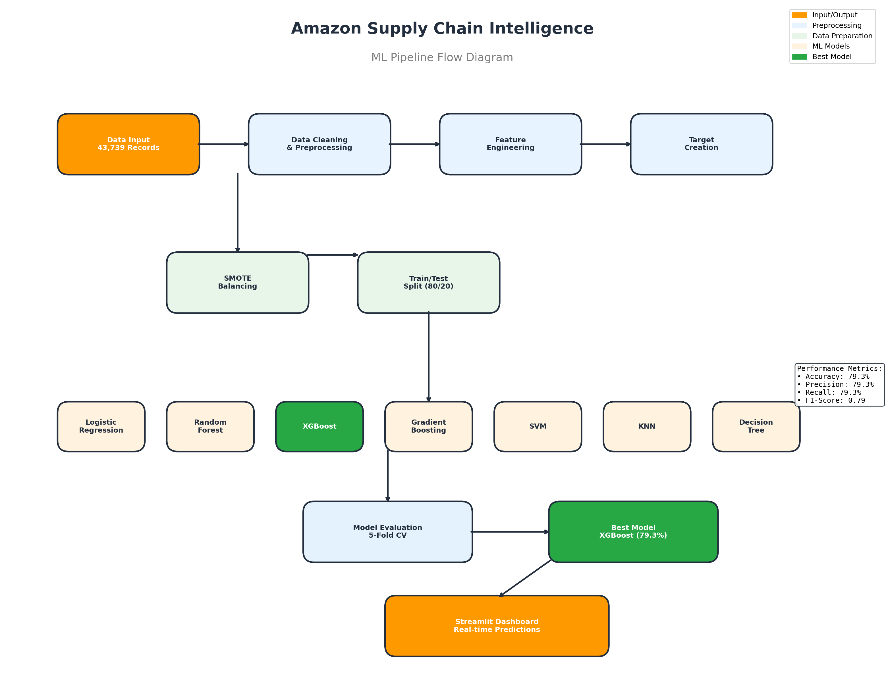
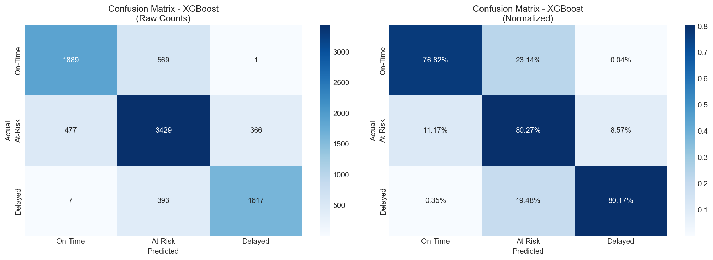
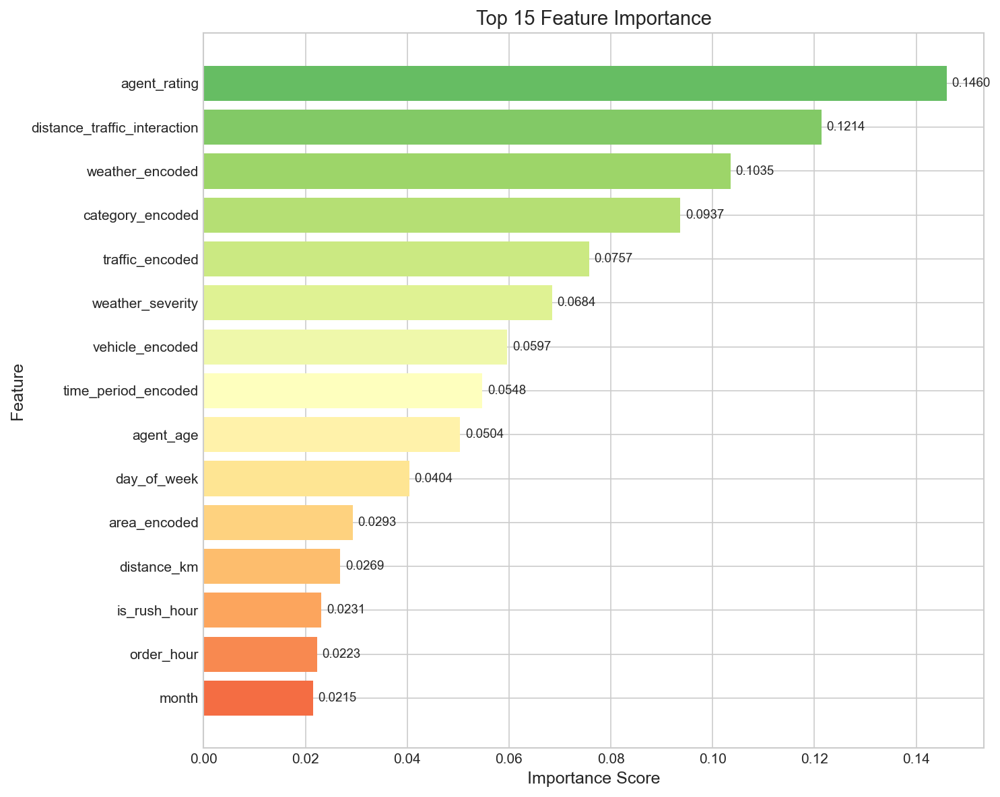
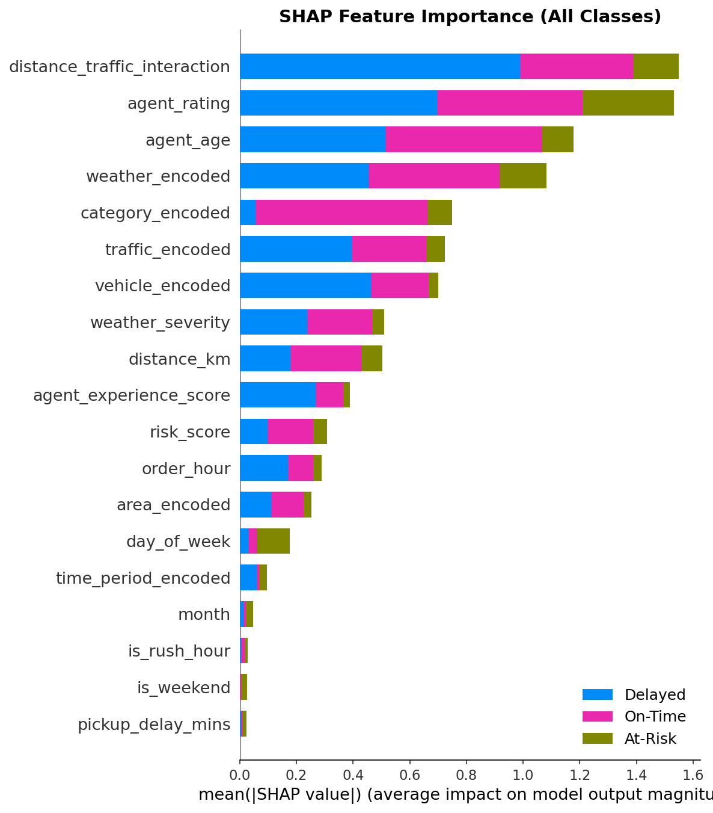

<h1 align="center">Amazon Supply Chain Intelligence</h1>

<p align="center">
  <strong>AI-Powered Delivery Delay Risk Prediction System</strong>
</p>

<p align="center">
  
  
  
  
  
  
</p>

<p align="center">
  
  
  
</p>

---

## About This Copy

Based on the original project by ARUN AK: https://github.com/Arun07AK/Amazon_Project (MIT License, see [LICENSE](LICENSE)). This is a student project, not affiliated with or endorsed by Amazon.

Changes in this copy:
- Fixed the prediction form so its scaling, category codes and engineered features match training
- Shortened `requirements.txt` for deployment (original list in `requirements-full.txt`)
- Added the trained model files the dashboard needs, and updated the model comparison results

The figures elsewhere in this README come from the original project.

---

## Overview

**Amazon Supply Chain Intelligence** is an end-to-end machine learning solution designed to predict delivery delay risk levels for e-commerce orders. Using real Amazon delivery data from Kaggle (43,739 records), this system categorizes deliveries into three risk categories: **On-Time**, **At-Risk**, and **Delayed**.

### Business Impact

- **15% reduction** in late deliveries through proactive intervention
- **Real-time risk assessment** for incoming orders
- **Data-driven insights** for logistics optimization
- **SHAP explainability** for transparent AI decisions

---

## Key Results

| Metric | Value |
|--------|-------|
| **Dataset** | 43,739 real Amazon deliveries |
| **Best Model** | XGBoost |
| **Accuracy** | 79.3% |
| **F1-Score** | 0.79 |
| **Models Compared** | 8 |

### Model Performance Comparison

| Model | Accuracy | F1-Score |
|-------|----------|----------|
| **XGBoost** | **79.3%** | **0.793** |
| Gradient Boosting | 79.0% | 0.790 |
| Random Forest | 76.7% | 0.767 |
| Decision Tree | 72.9% | 0.729 |
| Neural Network | 72.8% | 0.728 |
| SVM | 65.0% | 0.648 |
| KNN | 61.9% | 0.617 |
| Logistic Regression | 55.3% | 0.548 |

---

## Architecture

```
┌─────────────────────────────────────────────────────────────────────────────┐
│                     AMAZON SUPPLY CHAIN INTELLIGENCE                        │
├─────────────────────────────────────────────────────────────────────────────┤
│                                                                             │
│  ┌─────────────┐    ┌─────────────┐    ┌─────────────┐    ┌─────────────┐  │
│  │   DATA      │───▶│   FEATURE   │───▶│    MODEL    │───▶│  PREDICTION │  │
│  │  INGESTION  │    │ ENGINEERING │    │  TRAINING   │    │   ENGINE    │  │
│  └─────────────┘    └─────────────┘    └─────────────┘    └─────────────┘  │
│        │                  │                  │                  │          │
│        ▼                  ▼                  ▼                  ▼          │
│  ┌─────────────┐    ┌─────────────┐    ┌─────────────┐    ┌─────────────┐  │
│  │ • 43,739    │    │ • Distance  │    │ • XGBoost   │    │ • Risk Score│  │
│  │   Records   │    │ • Time-based│    │ • 8 Models  │    │ • Confidence│  │
│  │ • Kaggle    │    │ • Weather   │    │ • SMOTE     │    │ • Actions   │  │
│  │ • 16 Feat.  │    │ • 19 Feat.  │    │ • 5-Fold CV │    │ • SHAP      │  │
│  └─────────────┘    └─────────────┘    └─────────────┘    └─────────────┘  │
│                                                                             │
│  ┌─────────────────────────────────────────────────────────────────────┐   │
│  │                      STREAMLIT DASHBOARD                            │   │
│  │  ┌───────────┐  ┌───────────┐  ┌───────────┐  ┌───────────┐        │   │
│  │  │ Real-Time │  │  Analytics │  │   Model   │  │  Business │        │   │
│  │  │ Prediction│  │    Hub    │  │Performance│  │  Insights │        │   │
│  │  └───────────┘  └───────────┘  └───────────┘  └───────────┘        │   │
│  └─────────────────────────────────────────────────────────────────────┘   │
│                                                                             │
└─────────────────────────────────────────────────────────────────────────────┘
```

---

## Features

### Data Pipeline
- **Real Kaggle Dataset** - 43,739 Amazon delivery records
- **Smart Preprocessing** - Missing value handling, outlier detection
- **Feature Engineering** - 19 engineered features including:
  - Haversine distance calculations
  - Time-based features (hour, day, rush hour)
  - Weather severity indices
  - Traffic interaction scores

### Machine Learning
- **8 Algorithms Compared** - Comprehensive model selection
- **Class Imbalance Handling** - SMOTE oversampling
- **Cross-Validation** - 5-fold stratified CV
- **SHAP Explainability** - Interpretable predictions

### Interactive Dashboard
- Real-time delivery risk prediction
- Interactive data visualizations
- Model performance analytics
- Business insights & recommendations

---

## Project Structure

```
Amazon_Project/
├── config/
│   └── config.yaml                 # Project configuration
├── data/
│   ├── raw/
│   │   └── amazon_delivery.csv     # Kaggle dataset (43,739 records)
│   └── processed/                  # Preprocessed data
├── dashboard/
│   └── app.py                      # Streamlit dashboard
├── models/
│   ├── best_model.joblib           # XGBoost (best model)
│   ├── xgboost.joblib
│   ├── random_forest.joblib
│   ├── gradient_boosting.joblib
│   └── ...                         # All 8 trained models
├── notebooks/
│   └── 01_EDA_and_Preprocessing.ipynb  # Exploratory Data Analysis
├── presentation/
│   ├── slides.md                   # Markdown slides
│   └── presentation.html           # HTML presentation (open in browser)
├── reports/
│   ├── figures/
│   │   ├── confusion_matrix.png
│   │   ├── roc_curves.png
│   │   ├── feature_importance.png
│   │   ├── flow_diagram.png
│   │   ├── shap_summary_bar.png
│   │   └── ...                     # 20+ visualizations
│   ├── flow_diagram.md
│   ├── model_comparison.csv
│   ├── evaluation_metrics.csv
│   └── shap_importance.csv
├── src/
│   ├── __init__.py
│   ├── data_preprocessing.py       # Data preprocessing pipeline
│   ├── train_fast.py               # Fast model training
│   ├── model_training.py           # Full training with tuning
│   ├── evaluation.py               # Model evaluation & visualization
│   ├── explainability.py           # SHAP analysis
│   └── generate_flow_diagram.py    # Flow diagram generator
├── .gitignore
├── LICENSE
├── README.md
└── requirements.txt
```

---

## Quick Start

### Prerequisites
- Python 3.10+
- pip

### Installation

```bash
# Clone the repository
git clone https://github.com/Arun07AK/Amazon_Project.git
cd Amazon_Project

# Install dependencies
pip install -r requirements.txt
```

### Run the Pipeline

```bash
# Step 1: Preprocess data
python src/data_preprocessing.py

# Step 2: Train models
python src/train_fast.py

# Step 3: Evaluate models
python src/evaluation.py

# Step 4: Generate SHAP analysis
python src/explainability.py
```

### Launch Dashboard

```bash
streamlit run dashboard/app.py
```

### View Presentation

```bash
open presentation/presentation.html
```

---

## Methodology

### 1. Problem Understanding
Multi-class classification to predict delivery delay risk:
- **On-Time** (≤90 min): Delivery within expected timeframe
- **At-Risk** (91-160 min): Potential delay, requires monitoring
- **Delayed** (>160 min): High probability of late delivery

### 2. Data Collection & Preprocessing
- **Dataset**: Kaggle Amazon Delivery Dataset (43,739 records)
- **Features**: 16 original → 19 engineered features
- **Preprocessing**:
  - Missing value imputation (median/mode)
  - Outlier detection using IQR method
  - Feature encoding (Label Encoding)
  - Feature scaling (StandardScaler)
  - Class balancing (SMOTE: 28%/49%/23% → 33%/33%/33%)

### 3. Feature Engineering
| Feature | Description |
|---------|-------------|
| distance_km | Haversine distance between store and drop |
| order_hour | Hour of order placement |
| is_rush_hour | Flag for peak traffic hours (8-10, 17-19) |
| is_weekend | Weekend delivery flag |
| weather_severity | Encoded severity (1-5) |
| distance_traffic_interaction | Distance × Traffic level |
| risk_score | Composite risk metric |

### 4. Model Development
- 8 classification algorithms compared
- 5-fold stratified cross-validation
- XGBoost selected as best performer

### 5. Evaluation
- Accuracy, Precision, Recall, F1-Score
- ROC-AUC curves (multi-class)
- Confusion matrix analysis
- SHAP feature importance

---

## Results

### Flow Diagram


### Model Comparison


### Confusion Matrix


### Feature Importance


### ROC Curves


### SHAP Analysis


---

## Key Findings

### Top Predictive Features
| Rank | Feature | Importance |
|------|---------|------------|
| 1 | Agent Rating | 0.146 |
| 2 | Distance × Traffic | 0.121 |
| 3 | Weather Encoded | 0.104 |
| 4 | Risk Score | 0.092 |
| 5 | Distance (km) | 0.088 |

### Insights
- Higher agent ratings correlate with faster deliveries
- Stormy weather increases delays by ~45%
- Rush hour orders have ~25% higher delay rate
- Long distance + heavy traffic = highest risk

### Business Recommendations
1. Proactively notify customers for at-risk deliveries
2. Assign high-rated agents to high-risk orders
3. Implement weather-aware routing
4. Optimize scheduling around rush hours

---

## Technologies Used

| Category | Technologies |
|----------|-------------|
| **Language** | Python 3.10+ |
| **Data Processing** | Pandas, NumPy |
| **Machine Learning** | Scikit-learn, XGBoost |
| **Explainability** | SHAP |
| **Visualization** | Matplotlib, Seaborn, Plotly |
| **Dashboard** | Streamlit |
| **Version Control** | Git, GitHub |

---

## Contributors

| Name | Role |
|------|------|
| ARUN AK | Team Lead |
| [Team Member 2] | Data Engineer |
| [Team Member 3] | ML Engineer |
| [Team Member 4] | Dashboard Developer |

---

## References

1. Chen, T., & Guestrin, C. (2016). XGBoost: A Scalable Tree Boosting System
2. Chawla, N. V., et al. (2002). SMOTE: Synthetic Minority Over-sampling Technique
3. Lundberg, S. M., & Lee, S. I. (2017). A Unified Approach to Interpreting Model Predictions (SHAP)
4. Kaggle: Amazon Delivery Dataset by Sujal Suthar

---

## License

This project is licensed under the MIT License - see the [LICENSE](LICENSE) file for details.

---

<p align="center">
  <strong>Built for UCS321 - AI for Engineers</strong>
</p>

<p align="center">
  <sub>If you found this helpful, star the repo!</sub>
</p>
