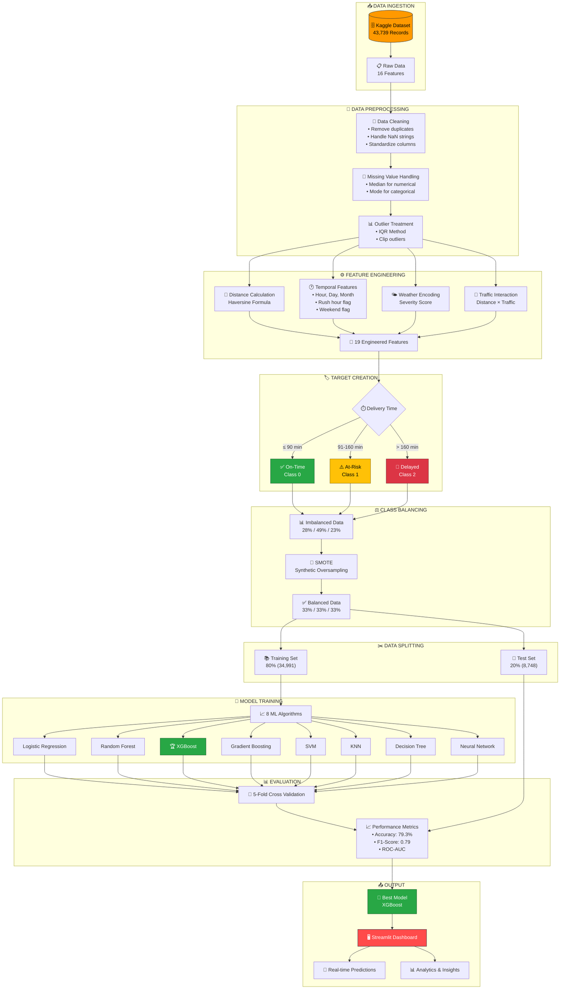

# Amazon Supply Chain Intelligence - System Flow Diagram

## Complete ML Pipeline Architecture

## Simplified Linear Flow

## Data Flow Summary

| Stage | Input | Process | Output |
|-------|-------|---------|--------|
| 1. Ingestion | Kaggle CSV | Load & Validate | 43,739 × 16 DataFrame |
| 2. Cleaning | Raw DataFrame | Clean & Standardize | Clean DataFrame |
| 3. Missing Values | Clean Data | Impute median/mode | Complete Data |
| 4. Outliers | Complete Data | IQR Clipping | Normalized Data |
| 5. Feature Engineering | Normalized Data | Create 19 features | Feature Matrix |
| 6. Target Creation | Delivery Time | Threshold binning | 3-class labels |
| 7. Balancing | Imbalanced Data | SMOTE | Balanced Data |
| 8. Split | Balanced Data | 80/20 split | Train/Test sets |
| 9. Training | Training Data | 8 algorithms | Trained Models |
| 10. Evaluation | Test Data | Metrics calculation | Best Model |
| 11. Deployment | Best Model | Streamlit | Live Dashboard |
